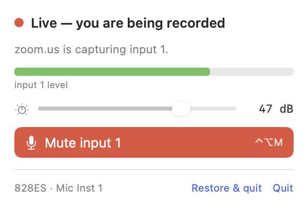

# MicMute

A menu-bar mute button for the microphone on **input 1 of a MOTU 828ES** — plus the
mic preamp gain and a live level meter.

The mute is applied **inside the interface**, in its own DSP, so it is independent of
Zoom, Teams, QuickTime or anything else that records. No app can undo it, and none of
them can even tell it is muted: they just receive digital silence.



## States

| icon | meaning |
|---|---|
| 🔴 red mic | live — not muted, and an app is capturing input 1 |
| 🟡 yellow mic (slashed) | muted, but an app is capturing — you are in a call, and safe |
| 🟢 green mic (slashed) | muted, nothing capturing |
| ⚪️ grey mic | not muted, nothing capturing — armed but idle |

Click the icon for the panel (mute, gain, level), right-click for the menu, or press
**⌃⌥M** to toggle from any app.

## Why it works this way

CoreAudio has nothing to help with here: the MOTU driver exposes **no input mute and no
input volume at all** — `kAudioDevicePropertyMute` and `VolumeScalar` simply do not exist
on the input scope of the device. So the mute has to happen in the interface, driven over
the MOTU HTTP datastore API (`http://828es.local/datastore`).

Out of the box the 828ES runs in *Interface* mode, where computer inputs are fed straight
from the inputs 1:1 and the mixer is not in the path — muting a mixer channel would do
nothing. So the app keeps this routing in place:

```
Mic Inst 1  ->  mixer channel 1  ->  Mix Group 1 L  ->  Computer 1
```

and the mute button flips `mix/chan/0/matrix/mute`. Measured against the direct path,
captured in the same instant:

| state | input 1, as apps see it |
|---|---|
| open | unity, **0.00 dB** difference from the direct path |
| muted | **exact digital zero** |

Mix Group 1 is alone on that bus, and its fader carries +2.5 dB to cancel the mono→stereo
pan law, so the recording level is unchanged and monitoring keeps its own level and pan.
If the interface is power-cycled or a preset is recalled, the app notices within a few
seconds and re-applies the routing.

## Requirements

macOS 13+, a MOTU 828ES reachable at `828es.local` (its mDNS name; the last host that
answered is remembered), and the MOTU Pro Audio driver.

Microphone permission is requested the first time the panel opens, for the level meter
only — no audio is ever recorded or stored. Denying it only costs you the meter.

## Build

```sh
sh build.sh          # -> MicMute.app
open MicMute.app
```

No dependencies, no Xcode project: one `swiftc` invocation over `Sources/*.swift`.

To put the interface back the way it shipped (uninstall step — the mute lives in the
mixer, so it stops working once nothing keeps that routing in place):

```sh
./MicMute.app/Contents/MacOS/MicMute --restore
```

There is a headless mode for debugging a setup without touching the menu bar:

```sh
./MicMute.app/Contents/MacOS/MicMute --probe            # state, routing, capturing apps, level
./MicMute.app/Contents/MacOS/MicMute --probe --verbose  # plus the CoreAudio process list
./MicMute.app/Contents/MacOS/MicMute --render out.png --live
```

## Reads once, then owns the microphone

There is no polling. At startup the app reads the datastore once, puts its routing in
place, and from then on it is the only thing managing input 1: what the icon and the slider
show is its own state, and every change it makes goes straight to the device.

Two things can invalidate that picture, and both are events rather than timers:

- **The interface went away or came back.** A listener on CoreAudio's device list catches it.
  When the 828ES reappears the app reads the datastore again and re-applies the routing,
  because a power cycle or a preset recall reverts the device to its own Interface routing —
  and a mute indicator that lies is worse than no indicator at all.
- **You open the panel.** One read, because that may be the first look in hours, and the gain
  knob on the front panel is physical.

Plus *Read settings from interface* in the menu, and a read after any failed write.

**"Is an app capturing"** comes from CoreAudio property listeners — the HAL's process list
plus each process's `kAudioProcessPropertyIsRunningInput` — so those callbacks fire only when
an app really starts or stops capturing.

The only timer in the program is the level meter, and it exists only while the panel is open.

Measured on this setup: 0.10 s of CPU for the whole startup read, and then **0.00 s over the
next three minutes** — the CPU-time counter did not move at all, RSS did not move, and there
was no socket to the device. (An earlier version watched the device through its long-poll,
which the device does support: `If-None-Match` answers `304` after ~10 s, or `200` with only
the changed keys. That cost 0.05 % of a core, forever, to watch a microphone this app already
owns.)

The trade: if something *else* changes input 1 on the device — the MOTU web UI, another
controller — this app will not notice until its next read. It is built to own the mic.

## Limits

- The mute lives in the hardware, so quitting while muted leaves the microphone muted.
  *Restore interface routing and quit* (panel or right-click menu) also unmutes and returns
  Computer 1 to the direct `Mic Inst 1` path — do that before uninstalling, or run
  `--restore`.
- "In use" means *any* app is capturing an input: macOS does not say which device a
  process holds (its per-process `kAudioProcessPropertyDevices` is empty), so the app
  names the app but cannot verify it took this interface.
- Nothing watches the device, so a change made by something else (the MOTU web UI, a second
  controller) is picked up at the next read, not immediately. That is the price of running
  at zero; *Read settings from interface* forces one.
- Everything device-specific lives in `Sources/Config.swift`: input bank/channel, mixer
  channel, group bus and the computer channel. On another MOTU AVB/Pro Audio model the
  bank numbers differ — read them from `ext/ibank/N/name` in `/datastore`.

## Licence

MIT.
